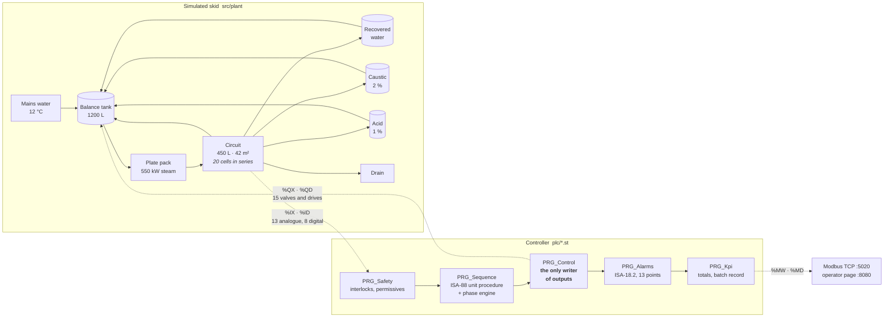
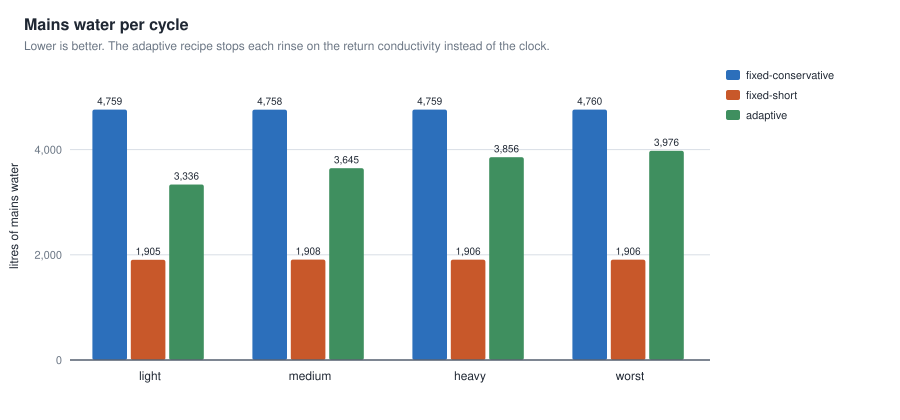
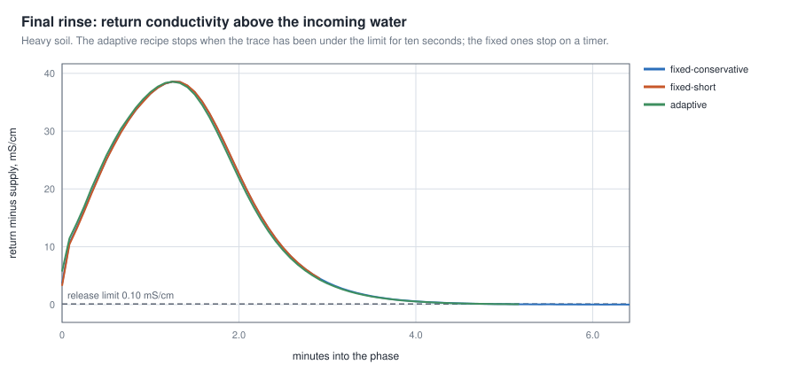
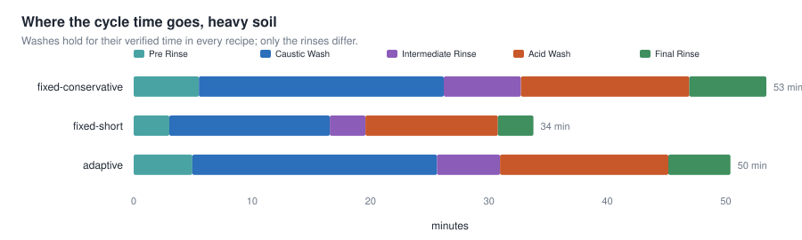
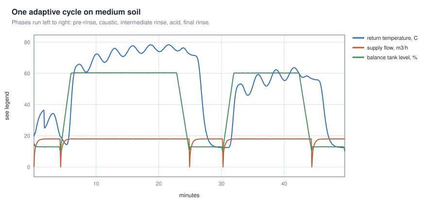

# plc-cip-batch-control

[](https://github.com/CGainsWorks/plc-cip-batch-control/actions/workflows/ci.yml)

An IEC 61131-3 Structured Text controller for a clean-in-place skid: the
machine that washes a dairy or brewery vessel between production runs. ISA-88
phase engine, ISA-18.2 alarm list, interlocks, two closed loops and a signed
batch record of what the cycle actually achieved.

It runs. There is no hardware, so the repository also contains a Structured
Text front end that executes the same `.st` source a controller would be given
and a first-principles model of the skid for it to be connected to.



---

## The result

Three recipes, four soil loads, twelve cycles, all reproducible from this
repository. The **adaptive** recipe holds the washes for exactly as long as the
conservative one and stops each rinse when the water coming back matches the
water going in instead of when a timer expires.

| Recipe | Cycle | Mains water | To drain | Steam | Released |
| --- | --- | --- | --- | --- | --- |
| `fixed-conservative` | 53.4 min | 4759 L | 3442 L | 126.6 kWh | 4 / 4 |
| **`adaptive`** | **50.0 min** | **3703 L** | **2761 L** | **124.7 kWh** | **4 / 4** |
| `fixed-short` | 33.8 min | 1906 L | 1642 L | 96.7 kWh | **0 / 4** |

**22 % less mains water, 20 % less effluent and three and a half minutes off
the cycle, with the batch released on every soil load.** Energy barely moves
(1.5 %) and it should not: the saving is in the rinses and the rinses are
not heated.



The interesting part is not the average, it is that the adaptive recipe
*spends what the soil needs*. The fixed recipe does the same thing whatever is
in the vessel, because it was sized for the worst case:

| Soil load | `fixed-conservative` | `adaptive` | Saved |
| --- | --- | --- | --- |
| light (28 g/m²) | 4759 L | 3336 L | 30 % |
| medium (80 g/m²) | 4758 L | 3645 L | 23 % |
| heavy (175 g/m²) | 4759 L | 3856 L | 19 % |
| worst (277 g/m²) | 4760 L | 3976 L | 16 % |



### And the part that matters more

`fixed-short` is the same recipe with the holds and rinses trimmed. It is the change
a plant under cost pressure actually makes. It is 20 minutes and 2,853 litres
cheaper, **every phase passes its own criteria** and the controller holds all
four batches anyway, because the final rinse leaves 294 mg/L of detergent in
the circuit against a 50 mg/L limit.

It also leaves soil behind: 0.21 g/m² on the heaviest load against the 1 g/m²
limit used here. Nothing in the controller can know that. It was asked for five
minutes of verified hold at 2 % and 75 °C and it delivered exactly that.

> **The controller verifies conformance to the recipe. It cannot tell that a
> recipe is inadequate.** What it contributes is evidence: the verified hold,
> minimum temperature, mean concentration and minimum flow it actually
> achieved, signed and hash-chained, so a recipe change can be argued about
> with numbers instead of opinions.



---

## Run it

No dependencies. Python 3.9 or newer, standard library only.

```bash
python scripts/run_cycle.py --recipe adaptive --soil heavy
```

```
Batch 1  recipe adaptive  soil heavy
  COMPLETE in 50.4 min
  PRE_RINSE            pass                 298 s to endpoint      minT  14.7 C  conc 0.00 %  end dC +0.239 mS/cm
  CAUSTIC_WASH         pass                 720/720 s verified hold minT  51.6 C  conc 2.01 %  end dC +0.012 mS/cm
  INTERMEDIATE_RINSE   pass                 319 s to endpoint      minT  12.4 C  conc 0.00 %  end dC +0.150 mS/cm
  ACID_WASH            pass                 360/360 s verified hold minT  45.9 C  conc 1.00 %  end dC +0.011 mS/cm
  FINAL_RINSE          pass                 315 s to endpoint      minT  12.4 C  conc 0.00 %  end dC +0.072 mS/cm
  water 3856 L fresh + 524 L recovered   chemical 51.1 L   steam 126.1 kWh
  RELEASED
  independent check: soil 0.0067 g/m2 (limit 1.0) OK; detergent 3.9 ppm (limit 50) OK
```

Watch it work, with Modbus TCP and an operator page, at twenty times real time:

```bash
python scripts/serve_hmi.py --speed 20 --autostart
```

Break it on purpose:

```bash
python scripts/run_cycle.py --recipe adaptive --fault pump-trip
```

Reproduce every figure above (about ten minutes):

```bash
python scripts/run_experiments.py
```

Check that the committed numbers still hold:

```bash
python scripts/verify_results.py --all
```

`make help` lists the rest.

---

## What the controller does

Full detail in [docs/control_narrative.md](docs/control_narrative.md); the
short version:

**One phase engine, six phases.** Pre-rinse, caustic wash, intermediate rinse,
acid wash, final rinse, sanitise. Every one of them is the same four steps
(line up, charge, circulate, recover) with different parameters, so
[FB_CipPhase.st](plc/fb/FB_CipPhase.st) is written once and the recipe supplies
an `ST_PhaseParams`. Adding a phase is parameters, not another copy of the same
logic.

**The hold timer only counts time that met the specification.** It advances
only while temperature, flow and strength are all inside their limits at once.
Ten minutes of verified hold means ten minutes of cleaning that met the
specification, not ten minutes on the clock. That is the figure in the
batch record, alongside the minimum temperature, mean concentration and minimum
flow behind it. Time, action, concentration, temperature: the four things a
cleaning validation asks about, each measured rather than assumed.

**Two interlocks earn their place.** No steam without proven flow, because a
steam-heated plate pack with no flow through it bakes the soil onto the plate
and eventually takes the gaskets with it. No dosing without a running pump, so
concentrate cannot sit undiluted in the balance tank. A dry-run detector stops
the supply pump after twenty seconds below 2 m³/h, because a pump moving
nothing is either dry or dead-headed and either destroys the seal in minutes.

**The temperature loop controls the return, not the supply.** The recipe
specifies a temperature at the soil and the coldest point of the circuit is
the one that has to reach it. Controlling the supply instead throttles the
steam as soon as one pass through the plate pack looks hot enough and the
balance tank then takes three times as long to come up. A proportional-only
high-limit override on the plate-pack outlet is low-selected against it;
proportional only on purpose, because an integrator on the losing half of a
selector winds up.

**An adaptive rinse has two guards and both are necessary.** The return
element sits downstream of the whole circuit, so a rinse that stopped after
twenty seconds would only have measured the water that was already in the pipe:
the minimum is one and a half circuit turnovers at the recipe flow, computed by
the controller from the circuit volume rather than typed into the recipe. And
if the endpoint is never reached the phase fails rather than running on.

**A stuck transmitter cannot release a dirty circuit.** Every rinse endpoint
rests on one conductivity element and the dangerous failure is not a dead
reading but a reading stuck at something clean. There is one point in the cycle
where the process guarantees a large signal. Circulating a wash at strength,
the return line is full of detergent, so an element that does not see at least
half the expected reading within three minutes of circulating is declared
faulty and both washes precede both rinses. This check exists because
[a fault test caught the hole](tests/test_faults.py) in the version without it.

**One writer.** `PRG_Control` is the only program that touches a field output,
which is what makes "what could possibly open the steam valve?" a question with
one answer.



---

## What is in here

```
plc/                    the deliverable: ~2000 lines of Structured Text
  types/                enumerations, structures, the global variable lists
  fb/                   FB_CipPhase, FB_UnitStateMachine, FB_Pid, FB_Pump,
                        FB_Alarm, FB_Totaliser
  prog/                 PRG_Safety, PRG_Sequence, PRG_Control, PRG_Alarms,
                        PRG_Kpi
src/iec61131/           a Structured Text lexer, parser and scan-cycle
                        interpreter
src/plant/              the skid: hydraulics, heat, conductivity, soil kinetics
src/harness/            one PLC, one plant, one scan loop; the I/O map
src/services/           Modbus TCP server and the operator page
src/report/             batch records with a hash chain and the SVG charts
tests/                  137 tests, from the sign of MOD to a pump trip mid-wash
results/                committed figures and twelve signed batch records
docs/                   control narrative, I/O map, model, alarms, limitations
```

### The Structured Text front end

`src/iec61131` is a lexer, a recursive-descent parser and a tree-walking
interpreter for the subset of IEC 61131-3 this project uses: the POU and
variable-block forms, `IF`/`CASE`/`FOR`/`WHILE`/`REPEAT`, enumerations,
structures, arrays, `VAR_IN_OUT`, the standard timers, counters and edge
detectors and located variables with `AT %IX0.0` addresses.

It implements PLC semantics rather than Python ones, which is the whole point:
integers wrap at their declared width, integer division truncates towards zero,
`MOD` takes the sign of the dividend, `REAL` to integer conversion rounds to
nearest, structures assign by value and timers read a simulated clock that
only advances because a scan says so, so a run is reproducible and a timer
behaves the same at a 20 ms scan as at 200 ms.
[tests/test_st_language.py](tests/test_st_language.py) is the contract.

**It is not a certified compiler.** No SFC, no ladder, no pointers, no
conformance suite. Before anything reached a controller the whole of `plc/`
would have to be compiled by the target vendor toolchain and the differences
dealt with. [docs/limitations.md](docs/limitations.md) is specific about this
and about what else would have to happen.

### The I/O map has one source of truth

The `AT` clauses in [GVL_Io.st](plc/types/GVL_Io.st) are it. The simulated
field bus, the Modbus register map and [docs/io_map.md](docs/io_map.md) are all
derived from them and CI fails if the document and the ST disagree. Adding a
coil is one line of ST.

```
%IXb.i -> discrete input  b*8+i      %IDn -> input registers 2n, 2n+1
%QXb.i -> coil            b*8+i      %QDn -> holding registers 2n, 2n+1
%MXb.i -> coil     1000 + b*8+i      %MWn -> holding register 1000+n
```

Only the memory area is writable by a client; writing a `%Q` point would be
overwritten by the next scan, so the server returns an illegal data address
rather than pretending. The Modbus server is written against the specification
rather than pulled in as a dependency and
[tests/test_modbus.py](tests/test_modbus.py) drives a whole cycle through it
over a real socket, starting it with a coil write.

### The plant model

Conservation of mass and energy; the circuit as twenty stirred cells in series,
which reproduces both the 90-second transport delay and its dispersion; soil in
three pools (loose, protein-bound, mineral) with Arrhenius temperature,
Michaelis-type concentration and wall-shear velocity terms: the usual time,
action, concentration, temperature decomposition, written out.

Conductivity comes from concentration through a curve with a quadratic
roll-off and the controller only has a two-point straight-line calibration of
it. That mismatch is deliberate: it is the normal state of affairs on a real
skid.

The structure is first-principles. **The coefficients are plausible rather than
measured.** The 23 % water saving is a property of this model. The mechanism,
a rinse that stops when the water is clean uses less water than one sized for
the worst case, is general. [docs/model.md](docs/model.md) gives every
equation and constant and says which are which.

Two quantities are tracked by the model and measured by no instrument on the
skid: residual soil on the wall and residual detergent in the circuit. They
appear in every batch record under `independent_check` and they exist to test
the controller's release decision, never to inform it.

### The batch record

One signed JSON document per cycle
([example](results/batch_records/10-adaptive-medium.json)), hash-chained to the
one before it so a record cannot be quietly edited or dropped from the middle
of a run. It carries the recipe, the verified hold and its four criteria per
phase, consumption, the alarm history, the release decision with its reasons
and the independent check.

---

## Verification

```bash
make test        # 114 unit tests, a few seconds
make test-all    # plus 23 end-to-end cycles with fault injection
```

[CI](.github/workflows/ci.yml) runs the lint, the whole suite, the generated
I/O map check, one re-run of a committed cell of the sweep with the batch-record
chain verified and a live start of the Modbus and HTTP servers that drives a
cycle and shuts itself down. The sweep is deterministic (seeded noise, no
wall-clock time in any output), so a re-run has to land on the committed
numbers or the build fails.

Everything that needs the full picture is in one job, because with nothing to
install a second job would cost more in runner start-up than it saved in wall
clock: 3.8 minutes for the lot, of which the twenty-three end-to-end cycles
are 2.8. Two one-job matrix legs then re-run the unit tests on Python 3.9 and
3.13, gated behind the first job so a real failure only costs one job's worth
of minutes. A superseded push is cancelled rather than finished.

The fault cases are the ones a commissioning engineer would try with the skid
in front of them: pump trip mid-wash, emergency stop, loss of the circuit
release, no steam, a derated heater, a conductivity element frozen clean, the
same element frozen dirty. Each asserts what the controller does about it and
each is a test that would be re-run against the real machine.

### Four things the tests caught

Worth listing, because this is what the suite is for:

* **An adaptive rinse that finished before the dirt arrived.** The return
  element is downstream of a 450 litre circuit, so the first version declared
  the pre-rinse complete after seventeen seconds: it had measured only the
  water already in the pipe. The fix is a blanking time the controller
  computes from the circuit volume and the recipe flow.
* **A HOLD that restarted the phase instead of freezing it.** `FB_CipPhase`
  had a hold branch that was unreachable, because the sequence dropped the
  execute request in HOLDING, so the restart looked like a fresh rising edge
  and began the phase again from zero. The engine now runs through a hold and
  is told it is holding.
* **A conductivity element stuck at a clean reading.** It satisfied every
  rinse endpoint the instant the blanking time expired and released a dirty
  circuit. Neither of the two rinse guards catches it. The wash plausibility
  latch does.
* **A water totaliser that under-read by 22 %.** It was gated on the make-up
  valve command, which is bang-bang level control on a break tank and toggles
  every scan or two, while the flow transmitter it integrated reports the
  previous scan. The two signals aliased. Gating on the source selection
  instead fixed it. The test that found it compares the controller's own
  totals against the volumes the model actually moved.

---

## Licence

MIT. See [LICENSE](LICENSE).
